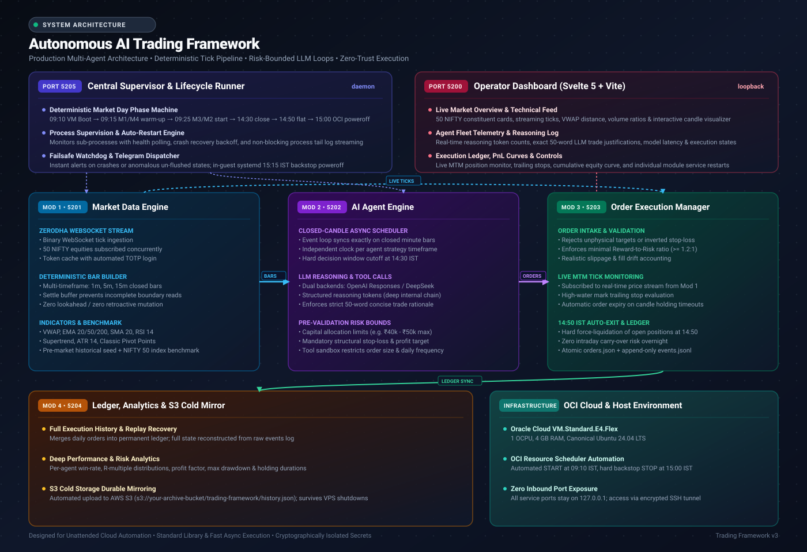

# Autonomous AI Trading Framework (v3)

<p align="center">
  
  
  
  
  
  
</p>

An enterprise-grade, deterministic algorithmic trading framework orchestrated by autonomous AI agent fleets. Built with strict architectural boundaries: broker sessions, candle building, multi-model LLM reasoning loops, risk-bound order execution, and durable cold performance archiving.

---

### Architecture Overview



---

## System Overview & Module Division

`v3` is engineered around four decoupled microservices operating on dedicated loopback interfaces, unified by a central supervisor daemon:

| Module | Port | Responsibility | Technical Stack | State |
|---|---|---|---|---|
| **Module 1: Market Data Engine** | `5201` | Zerodha Kite WebSocket tick feed, 50 NIFTY constituent master, deterministic candle aggregation (1m/5m/15m), and real-time technical indicator pipeline (VWAP, EMA, SMA, RSI, Supertrend, ATR, Pivots). | Python 3.12+, KiteConnect, NumPy | **Production** |
| **Module 2: AI Agent Engine** | `5202` | Closed-candle async event dispatching, multi-agent fleet scheduling, LLM reasoning loops (DeepSeek / OpenAI Responses API with high reasoning depth), 50-word rationales, and pre-trade tool execution sandboxing. | Python 3.12+, AsyncIO, OpenAI API | **Production** |
| **Module 3: Order Execution Manager** | `5203` | Paper order intake, risk/reward validation, tick subscription for live MTM tracking, trailing stop-losses, and mandatory 14:50 IST auto-exit liquidation. | Python 3.12+, Starlette, Atomic Ledger | **Production** |
| **Module 4: Ledger & Performance Archive** | `5204` | Event-driven order ledger, real-time analytics (Win Rate, R-multiples, Max Drawdown), NIFTY 50 benchmark tracking, and durable S3 cold-storage mirroring. | Python 3.12+, Boto3 / S3, Starlette | **Production** |
| **Central Supervisor / Runner** | `5205` | Process lifecycle orchestration, market day phase automation (09:10 - 15:00 IST), health probes, Telegram alerting, and automated OCI poweroff. | Python 3.12+, Systemd, Telegram Bot API | **Production** |
| **Operator Dashboard** | `5200` | Real-time reactive telemetry, live candle visualizer, fleet decision inspector, order book monitor, equity curves, and one-click service controls. | Svelte 5, Vite, TypeScript | **Production** |

The UI provides dedicated operational panels for each module, **Control** for central process supervision, log tails and service restarts, and **Design** for interactive message sequences, transport contracts, and system latency specifications.

```text
ai-trading-framework/
  module1/          Market Data Engine: broker auth, universe, candle builder, indicators, REST API
  module2/          AI Agent Engine: agent definitions, scheduler, LLM reasoning loops, tool sandbox
  module3/          Order Execution Manager: order intake, live tick subscription, MTM trailing, exits
  module4/          Performance Archive: historical ledger, analytics, NIFTY benchmark, S3 cold mirror
  runner/           Central Supervisor: market phase state machine, process manager, Telegram alerts
  ui/               Operator Site (Svelte 5 + Vite): multi-module dashboards, charts, control surface
  data/             Runtime data: instrument master, agent configs, order book, and history archive
  deploy/           Cloud deployment: OCI infrastructure, systemd units, automated schedules, runbooks
```

## Running it

### The day, and the runner

The framework works an operator's day, not the exchange's: it takes decisions
between **09:30 and 14:30 IST**, and nothing may stay open past **14:50 IST**.
The last candle of the day closes at 14:30 and is still answered - the settle
buffer means it is read a few seconds later - and the holding time of that last
order is counted from the candle, so it gets the whole twenty minutes the
window promises (14:30 to 14:50).

`python -m runner` is the **central process**, and it is what a cloud machine
runs. It is not a fifth trading module - it holds no market data and makes no
decision - it decides when the four services exist:

1. **Module 1 and Module 4 start together.** Market data is given at least a
   minute to stabilise - the broker session, the resolved universe, the history
   and the warm-up pass all have to say they are ready, the price feed has to be
   connected, and the indicators have to be computed for the universe - and only
   what depends on it waits. A fast answer is not mistaken for a stable one, and
   neither is history that has not been turned into values yet.
2. **Module 4 is not made to wait for that.** Reporting is useful whether or
   not the exchange is open: it keeps the long record and answers the dashboard
   from the archive, and it reads a local file and the order book, not Module 1.
   Starting it alongside Module 1 means the first reports exist before the
   market warms up, and a slow Module 1 never delays the archive.
3. **Modules 3 and 2 run for the trading day, once Module 1 is stable.** They are started about five
   minutes before the first decision (`FRAMEWORK_DAY_LEAD_SECONDS`) so the
   book and the agent clocks are in place, and stopped when their work can no
   longer be due: the agent fleet just after the last cycle, the order book
   once the day is flat and Module 4 has archived the day's book. Module 2's
   control service starts every defined agent by itself; each agent keeps its
   own clock and waits for the **next** candle of its own timeframe before it
   looks.
4. **It watches, and it stays.** A service that dies is restarted and
   reported, a health check that starts failing is reported once per change,
   and the process keeps running after the close. Outside the trading day the
   agent engine and the order book are *resting* rather than broken: the site
   says the market is not open, while Module 1 keeps the last available data
   and Module 4 keeps the reports. The next morning they are started again
   without anyone touching the machine.

The central process also serves its own control surface on
**127.0.0.1:5205** (`FRAMEWORK_CONTROL_PORT`), which is what the site's
**Control tab** reads:

- every service's state, pid, uptime, restart count and health, and the day's
  phase (starting, waiting for the market, trading, closing, day over);
- each service's own log and captured process output, as a live tail;
- a **Restart** (or **Start**, when the service is resting) button per service.

Nothing on that surface can place an order: it can only restart a service that
already exists, and the worst a restart can do is make a module re-read the
state it wrote to disk.

```powershell
cd ai-trading-framework
uv run python -m runner             # the whole shift, on the clock
uv run python -m runner --check     # print the configuration, send a test Telegram
uv run python -m runner --any-time  # ignore the window (development only)
```

Every hour is configurable: `FRAMEWORK_DECISION_OPEN`, `FRAMEWORK_DECISION_CLOSE`
and `FRAMEWORK_CLOSE`. On a weekend - or any day the runner's local NSE holiday
list marks closed - the central process starts only Module 1 and Module 4 and
reports the trading services as resting, naming the holiday when that is what
closed the day. The runner reads the local JSON file directly; it does not ask
Module 1 whether the market is open. Module 1 keeps fetching market data on a
holiday, and the runner starts no trading services at or after 14:30 IST, even
if the process was only started then.

### The operator's phone: Telegram

Put `TELEGRAM_BOT_TOKEN` and `TELEGRAM_CHAT_ID` in the secrets file (never in
this tree) and the framework reports to that chat:

- every order an agent decides: side, size, entry, stop, target, holding time
  and the reason in the model's own words;
- every transition Module 3 makes: received, filled (with the drift from the
  planned entry), closed (with rupees, percent and the R-multiple) and expired;
- failures: a lost broker session, a feed that stopped reconnecting, a model
  call that could not be reached, a service that died or was restarted;
- the milestones: the runner starting, Module 1 becoming stable, the agent
  fleet stopping, and the final day-book summary.

A notification can never block a cycle. It is queued and sent from its own
thread, a message with the same key is not repeated inside its dedupe window (a
reconnect loop becomes one message, not a hundred), and a send that fails is
logged and counted rather than raised. `TELEGRAM_ENABLED=false` mutes the
notifier without touching the credentials. Every process also writes a rotating
log to `logs/<service>.log`, stamped in IST.

### One click (this machine)

Double-click **`start-module-1.cmd`** in this folder. It starts the site if the
packages are installed, runs the runner in the window, and opens Firefox only
once **Module 1 is actually answering** - so the first thing on screen is
market data, not an error page. (The site itself no longer needs that care: a
tab opened before the framework recovers by itself.)

The click is handled by `start-framework.ps1`; the `.cmd` file is only the door
to it, because a batch file with Unix line endings loses its labels and closes
before printing a word. `FRAMEWORK_NO_BROWSER=1` starts everything without
opening a browser (a machine with a screen, but nobody watching it).

The browser is opened as a **window of its own** (`firefox -new-window`) once
Module 1 answers, not as a tab in whichever window happens to be focused -
"it opens the site" has to be true at a glance. Both the launcher and the
opener append what they did to `logs/launcher.log`, so a browser that did not
open can be answered from the file instead of from memory.

There is **one window**: the site runs quietly behind it as a helper
(`start-site.cmd`), its output going to `logs/site.process.log`, and it stops
when the runner window closes. A module that is not up yet answers the site
with a plain `MODULE_NOT_UP` instead of printing a stack trace on every retry.

If the framework is already running - the runner window is still open from
this morning - the script makes sure the site is up (starting it in the
background if needed), opens it, and says where the runner is.

The runner starts each service as a child process and appends what each one
prints to `logs/<module>.process.log`; the runner's own window shows what it is
deciding. It keeps the window open - and the site working - after the close, so
last available market data, reports and the Control tab are there all evening.
Closing the window (or Ctrl+C) stops the four services with it. If a
prerequisite is missing (no Python environment) it says exactly which command
to run and waits for you to read it.

### On a scheduled cloud machine

`python -m runner` is what a cloud machine runs (systemd, a scheduled task, a
container), and it is the only process that has to be supervised - it starts,
watches and stops the other four. On a VPS the shape is a systemd unit, an
instance that a schedule starts around the trading day, and - with
`FRAMEWORK_SELF_SHUTDOWN=true` - a runner that, once the day's book is
archived, stops every remaining service, checks that each process is really
gone, sends a **Market is off** Telegram message, and only then powers the
machine off itself. The final sync also forces Module 4's S3 mirror; a failed
archive upload keeps the machine up rather than losing the day. A service that
will not stop leaves the machine up and says why on Telegram. `deploy/` has the
systemd unit, a first-boot cloud-init script, an idempotent `bootstrap.sh`,
a failsafe power-off timer, and `deploy/README.md` - which also
covers what starts the instance on Oracle Cloud (Resource Scheduler, or a
Function if you want the Lambda shape).

### Current deployment

The live deployment is a dedicated Oracle VM in the `remote-dev` compartment,
region `ap-hyderabad-1`:

- **Instance:** `trading-framework-v3-2`, `VM.Standard.E4.Flex`, 1 OCPU / 4 GB,
  Ubuntu 24.04, 50 GB persistent boot volume.
- **Network:** existing `remote-dev-vcn` / `remote-dev-subnet`, with no
  application ports exposed.
- **Start:** OCI Resource Scheduler `trading-framework-v3-start`, weekdays at
  **09:10 IST** (`10 9 * * mon-fri`, `Asia/Kolkata`).
- **Stop:** the runner syncs Module 4, stops its services, and runs its
  poweroff wrapper; a 15:00 IST OCI `STOP_RESOURCE` schedule and a 15:15 IST
  systemd failsafe are installed as backstops.
- **Code/runtime:** `/opt/trading-framework-v3` and
  `/var/lib/trading-framework`; secrets are under
  `/etc/trading-framework`, outside the tree.
- **S3:** `s3://your-archive-bucket/trading-framework/history.json`.

At the 2026-10-20 documentation update the VM is stopped, the start schedule
is set for the next weekday at 09:10 IST, and the stop backstop is set for
15:00 IST.

The deployment runbook, IAM policy required by Resource Scheduler, exact
server layout and recovery notes are in
[`deploy/oracle-plan.md`](deploy/oracle-plan.md).

### By hand

Five processes. Module 1 first, then the rest. Nothing here needs the runner,
and nothing here knows about the trading window - the window is enforced by
Module 2 and Module 3 themselves, so a hand-started agent still stops at 14:30.

```powershell
cd ai-trading-framework
uv sync

# Module 1 on 127.0.0.1:5201
uv run python -m module1

# Module 2 on 127.0.0.1:5202, in a second terminal
uv run python -m module2

# Module 3 on 127.0.0.1:5203, in a third terminal
uv run python -m module3

# Module 4 on 127.0.0.1:5204, in a fourth terminal
uv run python -m module4

# the site on 127.0.0.1:5200, in a fifth terminal
cd ui
npm install
npm run dev
```

Open <http://127.0.0.1:5200>. The site talks only to its own origin; Vite
forwards `/api` to Module 1, `/agents` to Module 2, `/orders` to Module 3 and
`/report` to Module 4, and `/central` to the runner's control surface, so no
service needs a CORS surface and all of them stay on loopback. Only Module 1 is
required: each of the other tabs says so plainly when the module behind it is
not running - and the Control tab says whether the reason is a fault or simply
that the market is closed.

Secrets live outside the repository, in the file named by
`FRAMEWORK_SECRETS_FILE` (or in the environment). `.env.example` lists the
names. Nothing in this tree ever contains a credential.

## Module 1

### It signs in by itself

This is the point of the module, so it is worth being precise about. Kite has
two ways in and they are not interchangeable:

|  | Kite Connect access token | Web session (`enctoken`) |
|---|---|---|
| How it is obtained | API key, secret and a consent page | user id, password, TOTP |
| Can it be automated | no, the consent page is JavaScript | yes, completely |
| Lifetime | dies at 06:00 IST the next morning | weeks, until signed out |
| REST surface | `api.kite.trade` | `kite.zerodha.com/oms` |

Module 1 uses the second. On start it looks for a session in this order:
the one it already holds, then the shared cache on disk, then a fresh sign-in.
Nothing is ever asked of the operator: there is no prompt, no consent page and
no daily step. If the broker refuses the session, the module repairs itself -
preferring the shared cache, because another process may already have signed in
and signing in again would invalidate *its* session.

The cache lives at `%LOCALAPPDATA%\trading-framework\token_cache.json`, outside
this repository, written atomically. Its format matches v2's deliberately: one
account, one cache, so two processes cannot sign each other out.

### What it knows

- **Universe.** NIFTY 50, taken from the exchange's own constituent file
  (`niftyindices.com`), checked in at `module1/data/nifty50.csv` with a fetch
  date so a rebalance is a refetch rather than a guess.
- **Instruments.** Symbol to token resolution from the broker's public
  instrument dump, cached for twelve hours and usable offline.
- **History.** Daily candles per symbol, which give the previous close and the
  last completed session. Fetched in the background at start-up (~20 seconds
  for fifty symbols, rate-limited to respect the broker) and refreshed on a
  timer.
- **Live prices.** The websocket the Kite website itself uses. Kite's `/oms`
  API has no quote route at all, so this is the only way to get a live price
  with a web session.

### Timeframes, and the numbers on each candle

Eight timeframes: **1m, 5m, 10m, 15m, 20m, 30m, 60m, 1d**.

The broker is asked for one-minute candles only. Everything intraday is
aggregated here from that single base, because a 15-minute candle fetched
separately can disagree with the three one-minute candles inside it - and then
two parts of the same framework are looking at two different markets. Daily
candles are the exception: they are fetched directly, since deriving them would
mean holding months of minute data.

Buckets align to the **exchange session open**, not the clock hour: the first
15-minute candle of the day is 09:15-09:30, which is what the exchange's own
charts show.

Every candle carries:

| Field | Meaning |
|---|---|
| `change_percent` | close against the **previous candle's close** - how much this candle moved the price |
| `move_percent` | close against its own **open** - the candle's body |
| `range_percent` | (high - low) / low |
| `volume` | the volume in that candle, summed over its minutes |
| `volume_ratio` | volume against the average of the window, which is what makes the number mean anything |
| `minutes_present` / `minutes_expected` | so a gappy bar is visibly gappy |
| `is_complete` | false for the bar still forming at the moment of the request |

The site is organised the same way. Module 1 opens on a row of **timeframe
tabs** - 1m, 5m, 10m, 15m, 20m, 30m, 60m, 1D - and each tab is the whole
universe on that timeframe: one row per stock, carrying the company name, the
industry, that bar's open/high/low/close, its change, its body, its range, its
volume and volume ratio, the day's move beside it, and where the bar came from
(`live`, `exchange` or `mixed`). Switching tabs is computed in process, so it
costs no broker calls.

Clicking a stock opens an inspector pinned to the timeframe you were looking
at, with a candlestick and volume chart and the full candle history for that
symbol.

### Reading the table

Four things carry the weight that numbers alone cannot:

- **Trend** - a sparkline of the last 24 closes *on that timeframe*, so a row
  reads as a shape and not only a value. Twenty-four bars is about a session on
  15m and a month on 1D.
- **Change % carries its own magnitude** - the bar behind the number is scaled
  to the loudest move on screen, so the column can be scanned rather than read.
  It is a relative scale on purpose: in a quiet market the biggest mover still
  stands out from the rest.
- **Top / Bottom** - the best and worst of the timeframe, which is what an
  operator looks for first and would otherwise have to sort to find.
- **State** - `live`, `exchange` or `mixed` per row, with `*` for a bar still
  forming and `~` for one short of minutes. The table never implies that a
  number is fresher than it is.

### Light and dark

Two complete palettes, not an inverted one. The dark theme is built for a
terminal: true black is avoided so hairlines and shadows still read, and the
gains and losses are lifted bright enough to sit on a dark ground instead of
sinking into it.

The toggle is in the top bar. The choice is remembered, and a first-time
visitor follows their operating system. The theme is applied by an inline
script before the first paint, so there is no flash of the wrong palette - the
one piece of jank a themed app can always avoid.

### Indicators

Forty-five fields, ported from v2's engine into plain Python - no pandas, no
numpy - with v2's formulas, parameters and its rule about warm-up: **a value is
`null` until its window is complete**, never guessed. An RSI of 50 because
there is not enough history looks exactly like an RSI of 50 because the market
is balanced, and only one of those is worth acting on.

The list is also the filter vocabulary and the source of the table's columns, so
a value that is computed but not listed cannot be asked for by name at all - and
a model that can see a number in a stock's data will try to screen on it. Three
were in that state until recently. The previous session's high, low and close
now carry `surface="inspector"`: they belong in a screen and in the inspector,
but not as table columns repeating one number down the screen. And `above_vwap`
exists as a field of its own because a condition compares a field against a
value, never against another field, so "close above VWAP" cannot be written any
other way.

They are computed for every symbol on every timeframe, and they divide in two:

- **Session constants** - the previous session's high, low and close, the seven
  pivot levels, and the distance from the last close to the nearest of them.
  Computed once per symbol per session date.
- **Bar-driven values** - everything else, recomputed when a bar of *that*
  timeframe closes. Never on a forming candle: a value that flickers is worse
  than one a minute old, because you cannot tell which you are reading.

Each value carries the bar it belongs to, so the table can say which candle an
RSI refers to rather than implying it is live.

Two deliberate departures from v2, both recorded in `module1/indicators.py`:
VWAP and cumulative volume **reset at the session open** (v2 accumulated across
the series it was handed, which was one session; ours spans about six), and the
recursive indicators are smoothed over a bounded 300-bar window rather than
everything held. Measured against a 600-bar run, the worst difference that
bound introduces is 2.5e-9.

The field list, its groups and how to render each value live in one place and
are published at `/v1/market/indicators/catalogue`, so the UI builds its
columns from the source of truth rather than hard-coding forty names.

On the site, every field is its own column: the table scrolls horizontally
with the Symbol column frozen, and a row of group toggles - Trend, Momentum,
Volatility, Volume, Levels, Candle shape - switches whole classes off when you
are not reading them. The choice is remembered, the same way the theme is.
Boolean fields render as a filled or hollow dot rather than a number, and a
value with no history yet renders as a dash, never as zero.

Clicking a stock opens an inspector with a **Levels** block - the previous
session's high, low and close, then the seven pivots, with the nearest to the
last close highlighted - and the full indicator set grouped the same way.

### It never lies about freshness

Every row says where its price came from: `live`, `session close`,
`previous close`, or `no data`. A tick stops counting as live after two
minutes, so a quiet feed degrades into a labelled stored price rather than a
silently stale one. The header shows the exchange clock, the session state, the
feed state and the age of the history.

## How a live session runs

Three phases, and the important one is the middle: **during a session the
historical API is not touched for candles at all.**

**1. Warm-up, once, in the background.** Every symbol's one-minute history for
the current session is fetched and seeded into memory - about 50 requests and
18 seconds for fifty symbols. The board does not wait for it: day prices and
live ticks are already flowing while it runs.

**2. The live edge.** The websocket delivers ticks for all fifty symbols. Each
tick is folded into the minute being built; when the exchange clock turns the
minute over, that candle is closed, stored and announced. Every higher
timeframe is aggregated from those minutes in process, so 5m, 10m, 15m, 20m,
30m and 60m cost **zero** broker calls.

The builder will not bend on four things:

* a tick belongs to the minute of its **exchange** timestamp, so a late tick
  still lands in its own bucket;
* a minute that produced no tick is recorded as **missing**, never stitched
  over - a five-minute bar built from three ticks would otherwise look exactly
  like a real one;
* an out-of-order tick for a minute that already closed is ignored; the closed
  candle stays authoritative;
* volume is a **difference**, because the stream reports cumulative volume for
  the day.

**3. Gap repair** - below.

### Gap repair, in plain words

The websocket is like someone calling out prices across a room. It is fast, but
it does not call out every stock every minute - it skips around. So a minute
here and there has no price at all, which leaves a hole in the candle series. A
15-minute bar built across a hole is not a 15-minute bar; it is three minutes
and a guess.

Repair is the cleanup. Every few minutes the service looks for symbols with
holes and asks the broker's history for them. One request covers a whole day
and only the symbols that are actually short are asked about, so a pass over
the universe is tens of requests, not thousands. It does not need to be quick -
a hole found at 11:03 is just as fillable at 11:06 - and nothing waits on it.

That is what keeps the live loop free: the stream covers the present, history
covers the past, and repair is the small effort of making the two agree.

### One budget, two priorities

The broker's rate limit belongs to the account, not to a connection, so there
is a single token bucket every caller draws from. What it adds is priority: a
warm-up or a repair pass can be hundreds of requests, and without lanes a
person clicking a symbol waits behind all of them. Requests a person is waiting
on take the next token; background work uses whatever is left.

Measured on a real start-up: 108 calls to bring the whole universe up, 33
seconds of total waiting, with 92 tail probes avoided.

### Prices are pushed, not polled

The site opens one `EventSource` to `/v1/market/stream` and receives the board
whenever a price changes. Updates are batched to at most four a second: a tick
storm should not become a browser repaint storm.

The stream is not allowed to be the only path, because two things happen in
practice that it cannot survive:

- **A quiet tape pushes nothing.** The stream only speaks when a price *moves*,
  so on a closed market it is silent by definition. The board is therefore
  polled on a slow heartbeat (20 seconds) as well, which is also what fills a
  table that was drawn while history was still loading.
- **A refused stream is dead for good.** When the site is opened before the
  framework, the proxy answers 500, and an `EventSource` that is refused is
  failed for its lifetime - the browser retries a *dropped* connection, not a
  refused one. The tab rebuilds the stream itself every few seconds while it
  is down, and polls the board and status at the same time, so a site that was
  opened first comes to life on its own when Module 1 arrives instead of
  sitting on an error screen until somebody reloads it.

The five-second poll of the session and feed panels stays as it was: a dropped
stream degrades to slightly stale rather than frozen.

### The wire format, and the bug it caused

A websocket message is `[count][size]` followed by the packets - but the real
stride is **not** `size`. Every packet after the first is preceded by its own
two-byte length word, so a seven-packet message has packets at 4, 190, 376,
562, 748, 934 and 1120, not at multiples of 184.

Walking the buffer by `index * size` - the obvious reading, and the one the
previous attempt used - misreads every packet after the first, decoding a
token or a volume as though it were a price. That produced quotes of about
minus one crore rupees, which then failed candle validation, which took the
entire websocket down. `module1/tests/data/` holds a captured seven-packet
message that pins the correct framing.

The decoder is also defensive on principle: a packet is accepted only when it
names an instrument that was subscribed *and* carries a plausible price. Bad
packets are counted and dropped, and no decoding failure can escape into the
connection loop.

### API

| Route | Returns |
|---|---|
| `GET /health` | readiness, with the live state of each dependency |
| `GET /v1/market/quotes` | the board: fifty rows plus the board and market state |
| `GET /v1/market/prices?symbols=` | the latest price of the named stocks, with its source and age |
| `GET /v1/market/prices/stream?symbols=` | server-sent events: the named stocks only, and only when one moves |
| `GET /v1/market/universe` | the constituents with their resolved tokens |
| `GET /v1/market/timeframes` | the timeframes, and how they are built |
| `GET /v1/market/board?interval=` | every stock's latest candle on one timeframe - what the tabs read |
| `GET /v1/market/fields?interval=` | every field a screen may filter on, and the operators it takes |
| `POST /v1/market/screen` | filter the universe on one timeframe, ranked, for a shortlist |
| `GET /v1/market/symbol/{symbol}?interval=` | one stock's finished candle, its values, its levels, its day |
| `GET /v1/market/bar-status?interval=` | the candle that has just closed, and how many symbols' bars are finished being built |
| `GET /v1/market/events?interval=` | server-sent events: a candle closed on that timeframe, with the session state that decides whether it may be acted on. Nothing in v3 subscribes to it any more - the agent engine keeps its own clock - but it is still the module's own answer to "tell me when a bar closes" |
| `GET /v1/market/indicators?symbol=&interval=` | one symbol's latest indicator frame, its levels and its groups |
| `GET /v1/market/indicators/catalogue` | every field, its group, and how to render it |
| `GET /v1/market/candles?symbol=&interval=&limit=` | one symbol's candles with change, move, volume and volume ratio |
| `GET /v1/market/stream` | server-sent events: the board pushed as prices change |
| `GET /v1/market/status` | session, feed, board, instruments, broker counters |
| `GET /v1/market/session` | sign-in state; never a token |
| `GET /v1/market/session-clock` | session phase, the next open, and today's holiday from the local NSE list (for display; the runner does its own gate) |
| `GET /v1/market/holidays?year=` | the local NSE holiday list, its source and when it was fetched |
| `POST /v1/market/refresh` | force a history refresh |
| `POST /v1/market/session/login` | force a fresh sign-in |
| `POST /v1/market/session/logout` | forget the cached session |

## Module 2

### An agent is a fact, not a program

An agent is a configuration record: an id, a name, your system prompt, **one
decision timeframe**, an optional set of wider timeframes it may also read, and
the money it works with - capital, leverage, risk per trade, the most it may put
into one position, how long it may hold. It is defined in the Agent engine tab
of the site, stored as JSON under `data/agents/<id>/`, and validated once at the
edge, so nothing downstream has to wonder whether "4x" is a number.

The model is part of that record, not a global afterthought. New and edited
agents can choose `deepseek-v4-flash`, `gpt-6-luna`, or another compatible model
name. A `gpt-*` model uses `OPENAI_API_KEY` and
`MODULE2_OPENAI_BASE_URL` when that key is present; otherwise it falls back to
the default OpenAI-compatible gateway and `DEEPSEEK_API_KEY`, which supports
gateways that serve GPT model names with one credential.

Each agent runs as **its own process**, started and stopped by a control service
on port 5202. One agent hanging, looping or crashing takes that agent down and
nothing else.

### The one that comes with it

`logs/create_intraday_agent.py` creates **`nifty-intraday`**: a 5-minute agent
whose prompt is written to be permissive on purpose. The prompt a new agent
starts with spends a page on when to stand aside - right for an operator who
wants caution, wrong for one who asked for an intraday trader. This one names
the tools it has, the workflow expected of it, its per-order limit and its risk
budget, and tells it to read its own finished trades before it reads the market.

It is created through the registry like any other agent, so it can be edited or
retired in the site afterwards. Note that `logs/` is git-ignored: if you want
the prompt kept, re-run the script or copy it somewhere tracked.

### Its day

```
sleep  ->  a candle of ITS timeframe closes
       ->  decide what to filter on          screen(...)
       ->  inspect two or three survivors    stock(...), candles(...)
       ->  answer                            submit_decision(...)
       ->  sleep
```

It keeps **its own clock**. The session's hours come from Module 1 - when the
exchange opens is a market fact - but the schedule on top of them is the agent's
own, so a 15-minute agent wakes at 09:30, 09:45, 10:00 rather than being told
after the fact. Bars are aligned to the session open, not the hour, which is how
Module 1 builds them.

On top of that sits the **operator's day**: decisions run from 09:30 to 14:30,
and nothing stays open past 14:50. An agent that starts mid-session does not
pounce on the bar that closed a minute ago - it waits for the *next* boundary,
then reads that candle. Waking *at* the boundary means asking a moment before
the answer exists (a minute is only closed into the book when the first tick of
the next one arrives), so the read happens at the boundary plus a five-second
settle buffer (`MODULE2_CANDLE_SETTLE_SECONDS`), and then the agent asks Module 1
whether the bar has actually finished being built - usually about a second, and
never longer than `MODULE2_BAR_TIMEOUT_SECONDS`. That replaced a flat 45-second
sleep, which was a guess rather than a measurement.

The last candle of the day - the one closing at 14:30 - is decided like any
other, in the ninety seconds of grace after the close. Its holding time is
capped at what remains of the day, so an order taken then may hold twenty
minutes, not an hour; the prompt says so, and a plan that asks for longer is
refused with the room that is left. Module 3 enforces the same cap from its own
side, so a position cannot outlive the window even if a plan slips through.

Switching a timeframe yourself is not needed and not possible: the tool takes an
`interval` argument **defaulted to the agent's own timeframe**, and anything
outside the timeframes you allowed is refused without a request leaving the
process.

### One pass, as many answers as the candle deserves

A cycle shortlists two or three names and may trade more than one of them.
Everything it asks for **in one turn is fetched together** - three stocks and
their candle series are one round trip, not six - and several `submit_decision`
calls in one turn place several orders, each recorded separately and each
handed to Module 3 in parallel. One candle can carry several orders; it just
cannot be decided twice.

### Its own memory

An agent has no conversation memory of its own cycles: each one is a fresh
conversation, and nothing from the candle before survives into it. What it has
instead is two things, put in front of it before the model is asked anything:

* **What it is holding** - symbol, side, size, entry, stop and target for every
  open order. Nothing in the framework stops an agent opening a second position
  in a stock it already holds, so seeing them is what stops it happening by
  accident. One agent opened the same stock twice before this existed.
* **How the day has gone** - trades closed, rupees made, wins and losses, and
  the average result in R. An agent that cannot see its results has no way to
  notice that a way of reading this tape is not working.

It comes from Module 3's daily book, in one local request, and costs the model
no round of its own. The `orders` tool is still there for the detail behind it.

The third thing is the **notebook**: notes the agent wrote itself, keyed and
bounded, shown at the start of every cycle. It is the only memory that crosses
cycles, restarts and nights - after its decisions and before it sleeps, the
agent is required to update it with one `write`, `append` or `delete` saying
what the candle taught it (a cycle that decides and does not record is logged
as `notes_missing`, not pretended away). The notebook holds at most 24 keys of
600 characters, 6000 in total, and one lesson per key is the intended shape:
"ORL breaks with volume_ratio under 1: 3 losses in 12 trades", not "be careful".
It is re-read at the top of every cycle, so a note costs its own reading
forever - which is why the agent is told to delete what stopped being true.
On the final decision cycle the prompt asks for a whole-day lesson, then Module
2 writes a `session_checkpointed` record and stores a dated snapshot of the
notebook. The latest five snapshots live beside the live keys, and the next
trading day's first prompt names the most recent earlier checkpoint. A note
written during a day can therefore revise what the agent knows without erasing
the evidence of what it carried out of the previous close.
The operator sees it on the Agent engine tab and may delete one lesson or clear
the lot: the agent is the author, the operator is the editor. Notes are
advisory - nothing in the framework interprets them, and sizing, risk and the
trading window are unchanged by whatever a note says. It lives at
`data/agents/<id>/notes.json`, rewritten atomically like every other small file
there.

The loop holds two rules that matter more than the rest:

* **One candle, one decision.** The bar an agent last attempted is written to
  `state.json`, so a restart in the middle of a bar cannot decide it twice.
* **A candle nobody can act on is skipped.** The last bar of a session closes at
  15:30, when no order may be placed, so the agent does not spend a model call
  discovering that.
* **Not knowing is not the same as knowing it is closed.** The wake-up carries
  the session with it, and when a wake-up arrives without it the agent asks
  Module 1 rather than assuming - because assuming a closed market refuses every
  order on a live tape, and names a rule the market never broke.

### The tools

Seven reads and one terminal call. Five are thin wrappers over Module 1's
endpoints - `market_state`, `fields`, `screen`, `stock`, `candles` - and the
sixth, `orders`, asks Module 3 for *this agent's own orders*: what it is holding,
what each was entered at, where the target and stop are, the price now, and how
the trades it has finished turned out. There is no tool that places an order,
and none that reaches another agent: the order read is scoped to the agent that
asked and Module 3 filters on it, so a model cannot see another agent's book
however it phrases the request.

The seventh read is `notes` - the agent's own notebook, described above. Like
`orders` it is scoped to the agent that asked (the agent id comes from the
definition, never from a tool argument), and like `submit_decision` it is
exempt from the per-cycle tool-call budget: the mandatory write must not fail
because the budget for looking around ran out.

The model chooses its own filter, which is the point: it is not handed a
shortlist, and the screen it wrote is recorded with the decision so the
shortlist can be reproduced afterwards. `screen` answers for the **last closed
candle** and every row in one answer describes that same bar, so two conditions
in one filter can never compare two different candles. A field whose value is
`null` matches nothing: null means "not enough history yet", and treating it as
zero would select exactly the wrong stocks.

Nothing in the framework stops an agent opening a second position in a stock it
is already in. That is a risk rule, and risk rules are not in this slice — the
`orders` tool is what makes the mistake *visible* to the agent about to make it,
which the frame tells it to check before it decides.

### The answer

```json
{
  "action": "buy",
  "symbol": "TATAMOTORS",
  "quantity": 96,
  "target": 416.5,
  "stop_loss": 411.4,
  "entry_price": 412.9,
  "max_hold_minutes": 60,
  "confidence": 0.6,
  "reason": "close above VWAP with volume_ratio 3.1 and rsi_14 64; stop inside VWAP"
}
```

**The model does not choose the quantity**, and `submit_decision` has no
argument for it. A position is `risk budget ÷ stop distance`, capped by the
notional the agent's capital and leverage allow:

```
capital 50,000  x  leverage 4x        = 200,000 buying power
risk per trade  0.5% of capital       = 250 at risk
max one position 20% of buying power  = 40,000 notional

entry 412.90, stop 411.40  ->  risk/share 1.50  ->  166 shares by risk
                                                 ->   96 shares by notional
                                                 ->  qty 96, 144 at risk
```

Every rupee of that arithmetic is stored with the decision, so the size can be
re-derived rather than taken on trust - and it is *the plan*, not the fill. The
quantity is what Module 3 takes; the entry is where the market actually is when
it does, so the money a finished order risked is computed there, from the price
the position really was taken at. The decision keeps its own entry price beside
it, and the two are never conflated.

A decision is refused - and the refusal is handed back to the model, inside the
same cycle, naming the rule it broke - when the market is closed, when the price
is not a live tick, when the target
and stop are not on the right sides of the market, when a short is not allowed,
when the holding time exceeds the agent's limit, when the exit would land after
14:50 IST, when there is no reason, or when no whole share fits the risk and
notional limits.

### Watching one work

The Agent engine tab shows the registry on the left and the selected agent on
the right: what it is, the numbers it is bounded by, **a live feed** of every
tool call with its arguments, every result, the model's own words and every
decision as it happens, and the orders themselves as JSON cards. The feed is a
server-sent stream that survives a restart of the control service, because it
tails the log files rather than holding state in memory:

```
data/agents/<agent_id>/
  definition.json     what it is
  state.json          the last bar it attempted, and how that went
  activity.jsonl      every step, appended as it happens
  decisions.jsonl     the orders and the refusals, append-only
```

Retiring an agent stops it and moves its directory to `_retired/` rather than
deleting it: what an agent decided is the only record of why.

**Pausing an agent** is the gentler switch: `"enabled": false` in its
`definition.json` (or the Enabled checkbox in the Agent engine form) keeps the
agent defined, with its notes, activity and decisions readable and editable,
but nothing in the fleet starts it - not the morning start, not a restart, not
a direct `python -m module2 --agent <id>` - and the Start button refuses until
it is enabled again. It is how an agent is taken out of production without
losing its history.

### What it costs, and what it does not do

The system half of the prompt and the tool schemas are byte-identical between
cycles, so only the volatile part - the clock and the candle that just closed -
is new on each wake-up, and the provider's prompt cache does the rest. Model and
tool calls are counted per session and shown in the feed; there is no daily cap,
by the operator's decision.

A model that reasons and calls tools is reached through the **Responses API**:
from GPT-5.4 on, the provider allows function calling on Chat Completions only
when reasoning is switched off, so `MODULE2_LLM_API=auto` routes a GPT model
asked to think there and everything else to Chat Completions. The reasoning
effort is set per agent (`reasoning_effort` in its definition, default
`MODULE2_REASONING_EFFORT`) and recorded with every decision. The cost of a
session is still the conversation it re-sends, not the model: reasoning tokens
are billed as output but are not carried back into the next request.

Nothing here places a real order - and neither does the module that receives
one. The runner reads the local holiday list directly and never starts the
fleet on a holiday.

## Module 3

### From a decision to a position

A decision is a plan. Module 3 is what makes it a position, and keeps answering
the only four questions anyone asks about a trade: **has it been executed, did
it reach its target, did it hit its stop, or did it run out of the time it was
given.** An order is a record with four states and no others:

| State | Meaning |
|---|---|
| `pending` | accepted, waiting for Module 1 to confirm a *live* price |
| `open` | executed; the target, the stop and the clock are watched together |
| `closed` | finished, with `target`, `stop_loss` or `timeout` as the reason |
| `expired` | it never became a position inside the time it was given |

### Executed means one precise thing

There is no broker here and no adapter to add one: the module holds a position
itself or not at all. So "executed" is defined narrowly:

* **A fill happens at the first live price Module 1 publishes for the stock.**
  That price becomes the order's entry, and the money at risk, the notional and
  the P&L of a finished order are all computed from it. The price the plan was
  built on is kept beside it as `decision_entry_price`, with the distance
  between the two recorded as `fill_drift_pct`, so what was decided and what was
  taken never collapse into one number.
* **A stored close never fills an order.** A price labelled `session_close` or
  `previous_close` is one nobody could have traded at, so the order waits for a
  tick.
* **The plan must still fit the market.** Entering above a target means there is
  nothing left to gain, and entering below a stop means the trade was stopped
  out before it began, so a buy only fills strictly between the two - and the
  market must not have moved more than `MODULE3_MAX_FILL_DRIFT_PCT` (one percent
  by default) from the price the plan was built on. Either way the order expires
  with the reason and the numbers in its note, rather than being entered as a
  trade nobody decided on.

### The P&L a finished order carries

When an order settles, the settlement is stored with it rather than left to
whoever reads the ledger next:

| Field | Meaning |
|---|---|
| `gross` | what the trade made, in rupees |
| `capital` | what the position used: entry × quantity |
| `percent` | `gross` against that capital |
| `risk` | what the plan had at risk at the entry the order actually got |
| `planned_reward` | the target's distance × quantity |
| `r_multiple` | `gross` ÷ `risk` - the result in units of what it stood to lose |
| `reward_risk` | the reward-to-risk the plan offered at that entry |
| `outcome` | `win`, `loss` or `flat` |

Rupees say what happened; they do not say whether it was worth doing. A
hundred-rupee win that risked forty is a different trade from one that risked
four hundred, which is what the R-multiple is for. Every figure comes from the
entry the order actually got, so it describes the trade that was taken rather
than the one that was planned.

### Watching, without watching the whole market

Module 3 subscribes to the prices of the stocks it actually holds, and to
nothing else. That needed one addition to Module 1: `GET
/v1/market/prices/stream?symbols=`, which pushes only the named rows, and only
when a price or its source actually moves. The set changes as orders arrive and
finish, and every connection opens with a frame for each watched stock - which
is what stops a stock that never trades from leaving an order `pending` for
ever.

Under the stream there is a poll, for the same reason Module 1 has one: a quiet
tape produces no frames at all, and a deadline still has to be honoured.

The site shows exactly what is arriving - one price per watched stock, with how
long ago it was received - so the feed can be checked rather than trusted. The
age is recomputed from the tick each time it is read, so a stream that has gone
quiet shows as an ageing price instead of a fresh-looking one.

### Three exits, and the one that counts

Target, stop and the clock run concurrently and the first that becomes valid is
acted upon. Two rules keep that honest:

* **A target is never booked better than the target, and a stop is booked at
  the level or worse.** A gap through the target is real, but which side of it a
  fill would have landed on is not knowable from a snapshot, and assuming the
  favourable side is how a paper system lies.
* **When a single move clears both levels, the stop is the outcome that
  counts.** A snapshot feed carries no ordering inside the gap between two
  observations, so which level was touched first is genuinely unknowable.
  Booking the profitable one would be the most flattering mistake this module
  could make, so the order is closed against the position and says so, in
  `ambiguous_exit` and in a note on the row.

  In practice the fill rule keeps every entry strictly inside its plan, and any
  price at a level closes the order immediately - so this is a defence rather
  than a path an order currently takes. It stays because the exit rule must not
  depend on the fill rule for being correct, and the first change to how orders
  are entered should not be able to make it wrong unnoticed.

Several orders can be open in one stock at once, including from different
agents and in opposite directions. They are tracked independently and never
netted: two agents that disagree are two positions, and merging them into one
number would destroy the only thing that makes either judgeable.

The holding clock is capped by the framework's close, too. A plan taken at
14:10 that asks for an hour ends at 14:50 - that is when the operator's day
ends - and the close is stored on the order (`session_close_at`) so the deadline
is readable rather than inferred. An order that arrives after the close is
recorded and expired with the reason, never entered: by then the market it was
written for is one the framework has stopped trading. Every transition -
received, filled, closed, expired - is reported to the operator's Telegram.

### How an order gets here, and what happens if it does not

Module 2 records a decision and then hands it over. The hand-over is
best-effort: Module 3 may not be running, and a cycle that produced a good
decision must not be failed by a module that is not there to receive it. What
was recorded stays recorded, and the failure is written into the agent's
activity feed.

Module 3 meanwhile reconciles against Module 2's own decision log, on a timer
and on demand. Ingestion is idempotent on `decision_id`, so the push and the
pull can run at the same time and a retry after a timeout is harmless.
Reconciliation only looks back `MODULE3_RECONCILE_MAX_AGE_MINUTES` (two hours):
a decision from an earlier session belongs to a market that has since closed,
and booking it now would invent a position at a price that no longer exists.

### The ledger

`data/orders/` holds two files. `orders.json` is every order as it stands,
rewritten atomically; `events.jsonl` is every change, appended and never
rewritten. The checkpoint is the fast path and the log is the truth: if the
checkpoint is missing or unreadable, it is rebuilt from the log, so a process
killed between the two writes does not lose a trade.

### API

| Route | Returns |
|---|---|
| `GET /health` | what is tracked: open, pending, closed |
| `POST /v1/orders` | take a decision from Module 2; idempotent on `decision_id` |
| `GET /v1/orders` | the book, with the live price and the mark-to-market on each row |
| `GET /v1/orders/{order_id}` | one order |
| `GET /v1/orders/{order_id}/events` | every transition that order went through, oldest first |
| `GET /v1/orders/stream` | server-sent events: each transition, as it is written |
| `GET /v1/orders/days` | the daily book's index: every exchange day it holds, with that day's totals |
| `GET /v1/orders/summary?agent_id=&day=` | a period in one answer: open, closed, what it made, and the open positions themselves |
| `POST /v1/orders/prune?before=YYYY-MM-DD` | forget finished orders taken before a day; pass tomorrow to clear the book |
| `POST /v1/orders/reconcile` | ask Module 2 what it decided, now, rather than on the timer |
| `GET /v1/status` | the module, the price received for each watched stock, its subscription and its reconciliation |

### The daily book

An order belongs to the exchange day it was taken on, and that never changes:
`session_date` is stamped at intake from the IST date, so a day's book is a
lookup rather than a re-derivation. Nothing is grouped by UTC day, which would
split the Indian afternoon in half - 15:00 IST is 09:30 UTC, and every daily
total would be wrong.

`/v1/orders/summary` is the answer to "how is it going": counts, rupees, win
rate, the average result in R, the best and worst trade, and the open positions
themselves. Module 2 asks it for one agent before every decision.

### Keeping the day, not the history

The long history belongs to Module 4; keeping a second copy of it here is how
the two come to disagree. `POST /v1/orders/prune?before=` drops finished orders
taken before a date - both the checkpoint and the events that built them - so
the book stays the size of a day.

It is a request, not a policy. Nothing prunes on a timer, because deleting the
operational truth automatically is the kind of thing that should have a person
behind it. Two things it will not do: it will not touch an order that is still
open, since a position being watched is not history whatever day it was taken
on, and it will not guess at an order whose day it cannot work out. The answer
reports what was dropped, what was kept, and anything it refused to touch.

**It cannot know whether Module 4 has the orders yet.** That is the caller's
business, and the honest sequence is: sync Module 4, check the archive has them,
then prune. Passing tomorrow's date clears the book outright.

### What it does not do

It does not place an order, hold a credential, or open a broker connection - and
there is no adapter to add one to. It does not do pre-trade risk, capital
reservation or portfolio limits: Module 2 sizes a position inside the agent's
own limits and Module 3 takes the quantity it is given. (It does not take the
*entry* it is given: the position is entered at the market, so the money
actually at risk on a finished order is Module 3's number, not Module 2's plan.)
It does not model partial fills, and it does not trail a stop. All of that is
real work, and it belongs to the order manager; it is simply not in this slice.

## Module 4

### The day is not a history

Module 3 keeps the book of the day: what is open, what needs watching, what today
has made. That is an operational thing, and a day is the right size for it. It
cannot answer the questions that only a longer view can - is this agent any good
over a month, does it do better on some days than others, what does its average
trade actually make.

Module 4 is that longer view. It reads Module 3's book through Module 3's own
API, day by day, and keeps every order it has ever seen.

### What it reads, and how often

A finished day never changes: every order in it is closed by the time the
session ends. So a day is read once and read for good, except the newest couple,
which are still being written to and are read again on every sync. Any day the
archive has never seen is read whatever its age, which is what makes a dashboard
that was switched off for a week catch up rather than quietly missing the days
in between. A sync is therefore one or two requests most of the time, and never
a walk of the whole history.

It stores each order exactly as Module 3 describes it, minus the fields that
move while it is open - a price is a reading, not part of what happened, and
keeping it would rewrite the archive on every sync and make "has this order
changed?" unanswerable. One description of an order lives in one module, so if
Module 3 learns a new field this carries it without a change.

### What the agents spent

Token usage is not an order, so it is kept apart from the order archive, in
`data/history/tokens.json`. Module 2 owns the agents' activity logs and sums a
day's model replies into prompt, cached-input, completion and reasoning tokens
over its own `/v1/usage` route. Module 4 asks that route on every sync and
stores the totals; it never opens a file in another module's directory. The
totals only ever go up within a day, so a restart that briefly reports less
cannot erase what was already known.

The runner reads the totals into Module 4 **once more just before it stops
Module 2** after the last decision - the logs are the only copy, and the
engine's door has to be open when the last read happens. The Reporting tab
shows the latest day per agent, with model calls, cycles, prompt and cached
tokens, completion and reasoning tokens, and the day's total.

It also mirrors one observation per cycle. Module 2 groups the `model_reply`,
`tool_result`, decision and notebook events by their existing `cycle_id`, and
now writes a `cycle_finished` event with the process-measured wall duration.
That duration covers the model calls, parallel tool rounds, order hand-off and
notebook write, but not the sleep before the next candle. The usage route adds
`cycle_time_ms`, `model_time_ms`, `tool_time_ms`, `timed_cycles` and
`cycle_rows`, so Reporting can compare tokens and time per agent and inspect
the exact cycles behind an average. Tool calls in a round overlap; their summed
`tool_time_ms` is tool-thread work, not serial wall time. Older cycles without
`cycle_finished` are marked as derived from log timestamps rather than being
presented as measured.

The token record is local, like the order archive's fast path; it is not
mirrored to S3. A stale total is preferred to a missing one: a failed read
leaves what was recorded untouched.

### Compared with the market

An agent's P&L in rupees is not a performance comparison on its own: a week
when NIFTY 50 rose 2% is not the same week as one when it fell 2%. Module 4
also keeps the index's daily closes, read from Module 1's
`/v1/market/benchmark` route - the benchmark is a market fact, so it is fetched
by the module that owns market data, not invented here. The Reporting tab draws
it on the equity chart as a muted buy-and-hold line, sized to the same ₹50,000
notional as one agent's capital (configurable through
`MODULE4_BENCHMARK_NOTIONAL`), so an agent that made ₹200 in a week the index
made ₹800 on the same capital is visibly behind it.

The benchmark record is local (`data/history/benchmark.json`) and last-known-
wins: a failed read, or Module 1 not being up yet, leaves the previous closes
in place.

### The durable mirror

Module 4 keeps the local `data/history/history.json` as its fast read path and
mirrors the same archive to `s3://your-archive-bucket/trading-framework/history.json`
when `MODULE4_S3_BUCKET` is set. On start it merges the local and remote copies
by `order_id`; after a successful sync it uploads the merged archive. The
runner's final sync forces one last upload before shutdown, and a failed upload
keeps the VM up rather than losing the day. The object is private and
server-side encrypted. AWS credentials are read from the host's normal AWS
configuration, never from this tree.

### What it adds up to

Every table on the Reporting tab is built from one function, so the dashboard,
the per-agent table and the per-day table cannot disagree about what "realised"
means. It reports the numbers somebody would otherwise add up by hand - orders,
closed, rupees, win rate - and the one they could not: the average result in
units of the risk each trade carried, which is what makes a run of them
comparable.

The visual view goes further without changing the facts. Reporting is divided
into four views under one agent/day scope:

* **Performance** keeps the cumulative path, daily contributions, R histogram,
  exits, direction, agent scorecard and symbol contribution.
* **AI performance** shows prompt/completion/reasoning tokens, tokens per
  cycle, measured cycle wall time, model latency, tool-thread work, cache hit
  rate, notebook omissions and an exact per-cycle ledger. A cycle chart switches
  between wall time and tokens.
* **Order archive** is the searchable long book with status filters and exact
  fill, exit, holding-time, P&L and R records.
* **Data coverage** shows which days have trades, mirrored AI usage and measured
  cycle timing, alongside archive, benchmark and usage freshness and the limits
  of the record.

Drawdown is measured from the peak of the closed-trade path, not from an
account balance. An agent can be selected to scope every view together.

### API

| Route | Returns |
|---|---|
| `GET /health` | what the archive holds, and when it last synced |
| `GET /v1/analytics?agent_id=&day=` | chart-ready summary, curves, drawdown, R buckets, exits, sides and symbols |
| `GET /v1/performance?agent_id=&day=` | counts, rupees, win rate, average R, best and worst |
| `GET /v1/days?agent_id=` | one row per exchange day, newest first |
| `GET /v1/agents` | one row per agent, best first by what it has actually made |
| `GET /v1/orders?agent_id=&day=&status=&symbol=&limit=` | the long book |
| `GET /v1/usage?day=&agent_id=` | mirrored AI totals and per-cycle observations |
| `GET /v1/benchmark` | benchmark daily closes and the comparison notional |
| `POST /v1/sync` | read Module 3's book now rather than on the timer |
| `POST /v1/usage/sync` | read Module 2's usage now rather than on the timer |
| `GET /v1/status` | the archive, its settings and its last error |

### What it does not do

It does not decide anything, hold a position, or place an order - and there is no
adapter to add one to. It does not compute fees or taxes, so "realised" is gross;
it does not calibrate an agent's stated confidence against its results; and it
does not feed anything back into a prompt. Those are the pieces of the original
fourth-module sketch that are still missing, and the dashboard is the honest
first half of them.

## Tests

```powershell
cd ai-trading-framework
uv run python -m pytest # 721 tests: Module 1's decoder, sign-in, candles, screening,
                       # session clock with the holiday list, price watch and bar
                       # readiness; Module 2's schedule, trading window, rules,
                       # sizing, tools, order read, loop and control API; Module 3's
                       # state machine, exits, P&L, daily book and session window;
                       # Module 4's archive and the arithmetic the dashboard
                       # reports; plus the shared window/notifier/holiday list and
                       # the runner's readiness gate, holiday gate, day schedule,
                       # supervision, log tail and control surface
uv run ruff check .

cd ui
npm run build
node tests/smoke.mjs   # drives the real site in Chromium against Module 1
node tests/design-smoke.mjs # diagrams, SVG geometry, themes and narrow layout
node tests/reporting-smoke.mjs # four report views, cycle ledger, filters and narrow layout
```

### A whole session, when the market is closed

The real market is shut at night and on weekends, but the framework can still
be run end to end - with a fake market and a scripted model in front of the
**real** Modules 2, 3 and 4:

```powershell
cd ai-trading-framework
uv run python logs/sim_session.py --cycles 6 --model-latency-ms 350 --m1-latency-ms 40
uv run python logs/latency_report.py logs/sim/<stamp>   # re-print the report
```

* `logs/fake_module1.py` speaks Module 1's HTTP contract with synthetic,
  deterministic prices and a session clock that says the exchange is open; it
  reports a **new closed candle every minute**, so the agent's own clock wakes
  on real boundaries. `--latency-ms` adds a settable delay per request.
* `logs/fake_model.py` is an OpenAI-compatible provider that plays a believable
  cycle from the conversation it is given - `fields`+`screen`, then three
  `stock` and three `candles` calls in one round, then a decision, then the
  mandatory notebook write - and logs, for every request, whether the notebook
  digest and the reminder were actually in the prompt.
* Module 2's **control service runs the agent as a child process exactly as in
  production**, so the store, the prompt, the tools, the decision, the
  notebook, the hand-over to Module 3 and the archive in Module 4 are the real
  ones. Only the market and the model are simulated.

Every run ends with `report.md` / `report.json` under `logs/sim/<stamp>/`: the
stage latency per cycle (wake, model, tools, overhead, sleep), the tool-call
parallelism, the fake market's per-route latency, the decision → order → fill →
archive chain, and a pass/fail checks section - digests reached the model on
every call, the mandatory notebook write happened on every deciding cycle,
nothing failed. Add `--expect-missing-notes` to script the model *refusing* the
notebook: the run then proves the degraded path instead - the decision and the
order still stand, and every cycle is recorded as `notes_missing`.

**The full write-up lives in [`docs/simulation-report.md`](docs/simulation-report.md)**:
the method, the latency analysis, the defects the simulation found, and every
run's report as an appendix (`logs/` is git-ignored, so that document is the
durable copy). `logs/merge_reports.py` folds new runs into its appendix.

Measured on this machine, 1-minute candles, simulated model latency 350 ms ±
40 ms:

| stage | p50 | p90 | max |
|---|---|---|---|
| wake (bar close → first call) | 1.18 s | 1.18 s | 1.19 s |
| model (sum of calls in the cycle) | 1.40 s | 1.40 s | 1.42 s |
| tools (per cycle, parallel rounds) | 0.13 s | 0.13 s | 0.13 s |
| orchestration overhead | 0.12 s | 0.13 s | 0.14 s |
| whole cycle | 1.65 s | 1.65 s | 1.67 s |
| sleep to the next boundary | 58.5 s | 58.3 s | 58.7 s |

With the fake market slowed from 40 ms to 200 ms per request, the same ten tool
calls per cycle went from ~0.50 s of serial work to ~1.85 s - but the round's
wall time only rose from ~0.14 s to ~0.46 s, because a round's calls run in
parallel. That is the measured case for batching tool calls rather than
spawning more agents.

The browser test opens the site, waits for the board, checks six tabs and
fifty rows, filters, walks the Agent engine tab (including that the registry
poll cannot steal the selection from a half-filled new-agent form), the Order
manager tab and the Reporting tab, checks a narrow viewport for overflow, and
fails on any console or page error. Modules 2, 3 and 4 are optional for that
test - when one is not running its tab has to *say* so, and the test checks that
it does. Screenshots land in `logs/qa/`.

`logs/` also holds two scratch tools for checking the order manager without a
broker session: `module1_stub.py` serves Module 1's two price routes with a
price that can be moved on demand, and `orders_ui_check.mjs` drives the real
site through a whole order life - pending, filled, closed at the target - and
fails on any console error. A third, `coldstart_check.mjs`, watches what the
Market tab does when the site is open before the framework and confirms it
recovers by itself once Module 1 answers. None of them is part of the
framework.

## Known limits

- **The trading window is operator policy, and it is not the exchange's day.**
  Decisions run 09:30-14:30 IST and nothing stays open past 14:50 IST, by
  default. The window is an environment setting, not a market fact; the
  exchange's own day - hours, weekends and holidays - is enforced by the
  runner's own local holiday check, and the central process does not start the
  trading services outside it. Module 1 runs on a holiday so its last known
  data and indicators remain available.
- **Module 4 reports gross P&L.** No fees, no taxes, no slippage model, so the
  rupees on the dashboard are what the trades moved, not what they cost to run.
- **Nothing feeds the record back into a prompt automatically.** The agent's
  daily book reaches it before every decision; the longer history does not, and
  the agent's stated confidence is not yet calibrated against its results. That
  calibration is the piece of the original fourth-module sketch still missing.
- **Module 3 enters at the market, not at the price the plan was made on.** The
  quantity is Module 2's, so a position entered away from the planned price
  carries a different amount of risk from the one the sizing arithmetic
  describes - which is exactly why the entry, the risk and the P&L are all
  recorded from the price the order actually got, and the plan's own price is
  kept beside them. The bound on how far that can drift is the guard: past one
  percent, or past either level, the order expires instead of entering.
- **Module 3 does no risk, capital or portfolio accounting.** No partial fills,
  no trailing stop, no reservations, no per-agent exposure limit; the sizing is
  whatever Module 2 already did. All of that belongs to the order manager and
  is simply not in this slice.
- **An order missed for longer than the reconciliation window is not
  recovered.** If Module 3 is down for more than
  `MODULE3_RECONCILE_MAX_AGE_MINUTES`, the decisions from that gap are left
  alone rather than booked against a market that has moved on.
- **Module 3 knows only what Module 2 decided.** It has no view of anything
  held outside the framework, so it cannot tell an unhedged position from a
  hedge, and nothing it reports is an account of broker state.
- **The holiday list is only as fresh as its last good fetch.** NSE publishes a
  year at a time (the next year's list lands around November-December), so a
  January without a fetched list is scheduled by weekday; the runner says the
  year is not covered, and Module 1 keeps retrying until the fetch lands. The
  checked-in seed covers 2026.
- **A daily candle appears after the close.** While a session is running, the
  last completed session is the reference and the live tick is the price. That
  is why rows carry a source label.
- **The feed is a sampler.** Kite reports a fraction of a subscribed universe
  each minute, so a quiet symbol can go minutes between ticks. The row ages and
  the source label make that visible rather than hiding it.
- **The broker's minute history for the cash segment ends at 15:14.** The
  final fifteen minutes of an NSE session are not published as one-minute
  candles for these symbols, so the last bar of the day is the 15:00-15:15
  bucket. Daily candles come from the broker's own daily series and are
  unaffected. This was verified directly against the API, not inferred: a
  request for 15:14-15:30 on a past session returns exactly one candle.
